<p align="center">
  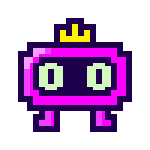
</p>

<h1 align="center">MascotAI</h1>

<p align="center">
  Um mascotinho que fica no canto da tela, por cima de tudo, e responde suas perguntas usando uma IA que roda no seu próprio PC.
</p>

<p align="center">
  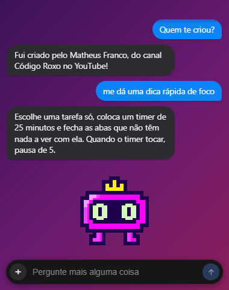
</p>

---

## A ideia

Eu queria algo parecido com o pet que o ChatGPT colocou no app: um bonequinho na área de trabalho que você clica e pergunta alguma coisa rápida, sem abrir navegador, sem trocar de janela.

A diferença é que aqui a IA é **local**. Ela roda pelo [Ollama](https://ollama.com), no seu computador. Nada do que você escreve sai da sua máquina, não precisa de conta e não tem limite de uso.

E se você não quiser IA nenhuma, dá pra deixar ele só como decoração, fazendo companhia.

O boneco foi desenhado à mão, em pixel art, com animação de poucos quadros por segundo. A ideia é ele parecer que está ali paradinho, respirando, esperando você.

## O que ele faz

- Fica sempre por cima das outras janelas, sem fundo e sem borda. O clique passa direto pelas áreas vazias.
- Um clique abre a caixa de texto. A resposta aparece em bolhas, estilo mensagem de celular.
- Mostra o que está acontecendo pelo rosto: pensando, falando, deu certo, deu erro.
- Respira, pisca, olha pros lados, fica com sono quando você some e dorme.
- Dá pra arrastar pra qualquer lugar da tela, e ele lembra a posição.
- Responde em 7 idiomas.
- Tem uma memória de fatos sobre você, pra não sair inventando.
- Lista, baixa e troca de modelo pelo próprio app.
- Liga e desliga o Ollama sozinho.

## Instalação

### 1. Instale o Ollama

Baixe em **[ollama.com/download](https://ollama.com/download)** e instale normalmente. É ele quem roda a IA.

> Se você só quer o mascote como decoração, pode pular essa parte e escolher o modo **Só decoração** nas configurações.

### 2. Instale o MascotAI

Baixe o instalador na página de **[Releases](../../releases/latest)**:

- `MascotAI-Setup-x.x.x.exe`: instala e cria atalho no menu Iniciar.
- `MascotAI-x.x.x-portable.exe`: roda direto, sem instalar.

O instalador não é assinado (certificado de assinatura é caro), então o Windows pode mostrar a tela azul do SmartScreen. É só clicar em **Mais informações** → **Executar assim mesmo**. O código está todo aqui, se quiser conferir antes.

### 3. Baixe um modelo

Abra as configurações (botão direito no mascote) e vá na aba **Baixar modelos**. Tem três sugestões, com os requisitos de cada uma:

<p align="center">
  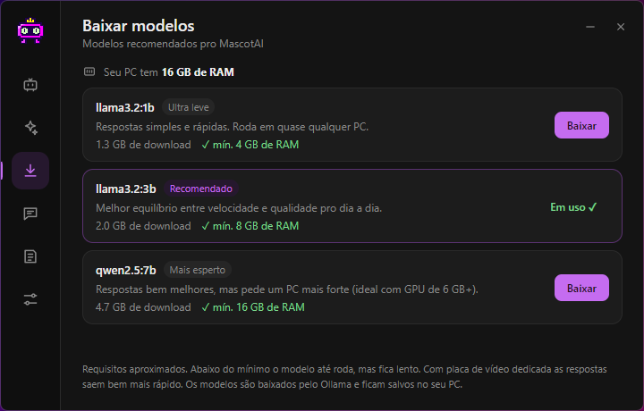
</p>

| Modelo | Download | RAM mínima | Pra quem |
|---|---|---|---|
| `llama3.2:1b` | 1,3 GB | 4 GB | PC fraco, respostas simples |
| `llama3.2:3b` | 2,0 GB | 8 GB | **Recomendado.** Bom equilíbrio |
| `qwen2.5:7b` | 4,7 GB | 16 GB | Respostas melhores, ideal com placa de vídeo |

Se preferir o terminal:

```bash
ollama pull llama3.2:3b
```

Qualquer modelo que você já tenha no Ollama aparece na aba **Inteligência**.

## Como usar

<p align="center">
  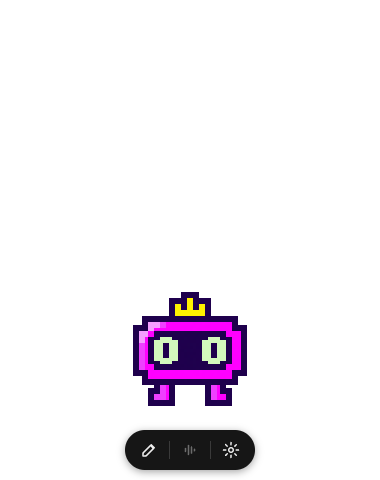
  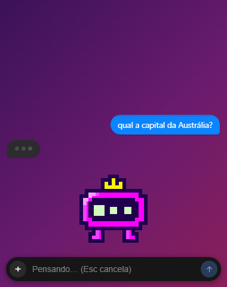
  
</p>

| Ação | O que acontece |
|---|---|
| Passar o mouse | Aparece a barrinha com escrever, voz (em breve) e configurações |
| 1 clique | Abre/fecha a caixa de texto |
| 2 cliques | Liga/desliga o modo em que ele segue o mouse com os olhos |
| Arrastar | Muda ele de lugar |
| Botão direito | Abre as configurações |
| `Ctrl + Alt + Espaço` | Abre a caixa de texto de qualquer lugar |
| `Esc` | Fecha a caixa, ou cancela a resposta enquanto ele pensa |
| **+** na caixa de texto | Começa uma conversa nova |

Pelo ícone na bandeja do Windows (perto do relógio) dá pra mostrar/esconder, voltar ele pro canto, iniciar o Ollama, sair só do mascote ou **encerrar tudo**, que fecha o Ollama junto e libera a memória da placa de vídeo.

<details>
<summary>Segredos</summary>

- Clicar muitas vezes seguidas deixa ele bravo.
- Clique com o botão do meio nele. Ou peça pra ele "mostrar a língua".
- Às vezes ele faz isso sozinho, quando acha que ninguém está olhando.

</details>

## Configurações

<table>
  <tr>
    <td>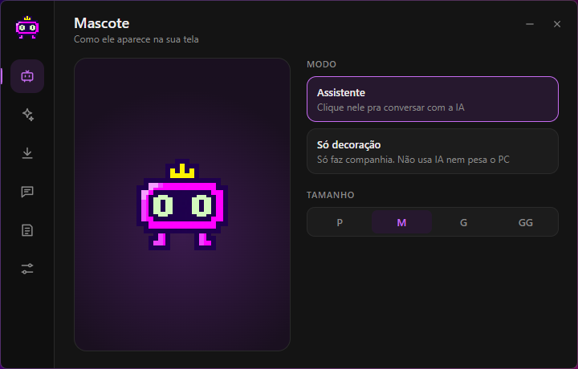</td>
    <td>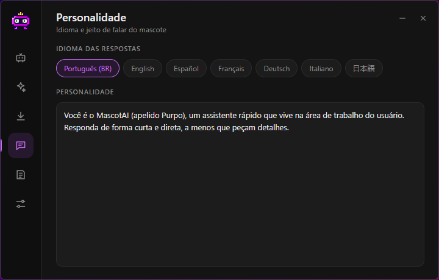</td>
  </tr>
  <tr>
    <td><b>Mascote:</b> modo assistente ou só decoração, e o tamanho (P, M, G, GG). A prévia mostra o tamanho real.</td>
    <td><b>Personalidade:</b> idioma das respostas e o jeito de falar.</td>
  </tr>
  <tr>
    <td>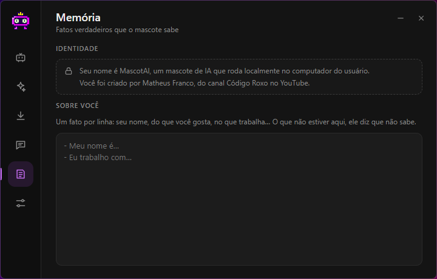</td>
    <td>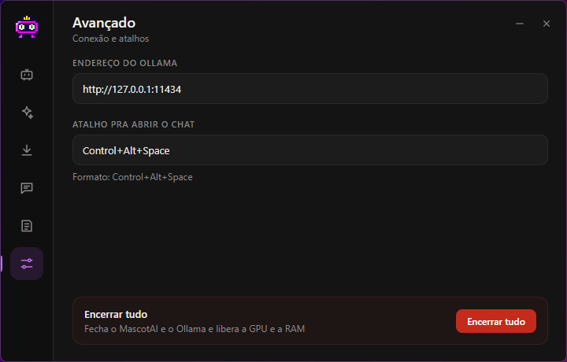</td>
  </tr>
  <tr>
    <td><b>Memória:</b> fatos sobre você. Ele usa só isso pra falar de você e diz "não sei" pro resto.</td>
    <td><b>Avançado:</b> endereço do Ollama, atalho e o botão de encerrar tudo.</td>
  </tr>
</table>

Tudo é salvo na hora, sem botão de salvar. O arquivo fica em `%APPDATA%\mascotai\config.json`.

### Sobre o desempenho

- O modelo fica carregado na memória por 30 minutos depois da última pergunta. A primeira resposta depois disso demora uns segundos a mais.
- O uso de memória não cresce com a conversa. O contexto é fixo em 4096 tokens, e as mensagens mais antigas vão saindo quando não cabem mais.
- Depois de 30 minutos parado, a conversa recomeça do zero.
- No modo **Só decoração** a IA não é chamada nunca.

### Por que ele não inventa (tanto)

Modelos pequenos chutam quando não sabem. Pra diminuir isso:

- a identidade dele (nome e quem criou) é fixa no código;
- o que ele sabe sobre você vem só da aba **Memória**;
- ele tem instrução explícita pra dizer "não sei" em vez de inventar nomes, links, datas e números;
- a temperatura é baixa (0,4).

Ainda assim, é um modelo de 3 bilhões de parâmetros rodando no seu PC. Pra conhecimento geral e coisas recentes ele pode errar.

## Animações

Cada estado é uma sequência de PNGs de 700×700, desenhados numa grade de 50×50.

| | | | |
|:-:|:-:|:-:|:-:|
|  |  | 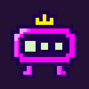 | 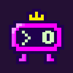 |
| parado | olhando em volta | pensando | falando |
| 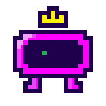 | 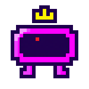 | 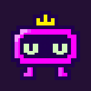 | 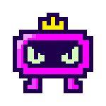 |
| terminou | erro | cansado → dormindo | bravo |

Todos os frames:

<p align="center">
  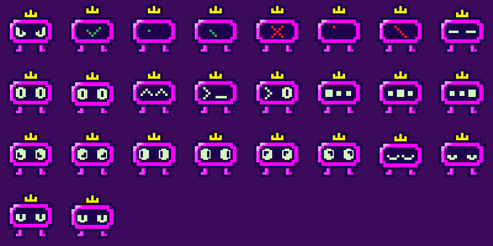
</p>

### Desenhando frames novos

1. Desenhe em 50×50 e exporte em 700×700 (cada pixel vira um quadrado de 14×14), com fundo transparente.
2. Mantenha o corpo e os pés no mesmo lugar em todos os frames. Pra "respirar", desça tudo 1 pixel (veja `face_eyes` e `face_eyes_low`).
3. Salve em `assets/sprites/frames/`.
4. Em `src/pet.js`, adicione o nome em `FRAMES` e crie o estado em `STATES`:

```js
meuEstado: { frames: [['frame_a', 200], ['frame_b', 200]], next: 'idle' },
```

`next` é pra onde ele vai quando a animação termina. Sem `next`, fica em loop.

## Rodando pelo código

Precisa do [Node.js](https://nodejs.org) 20 ou mais novo.

```bash
git clone https://github.com/CodigoRoxo/MascotAI-Purpo.git
cd MascotAI-Purpo
npm install
npm start
```

Pra gerar o instalador e a versão portátil (saem na pasta `dist/`):

```bash
npm run dist
```

### Estrutura

```
main/
  main.js            janelas, bandeja, atalhos e conversa
  config.js          configurações salvas
  identity.js        quem ele é (fixo)
  languages.js       regra de idioma de cada língua
  history.js         corta a conversa quando passa do contexto
  ollamaProcess.js   liga o Ollama em segundo plano
  providers/         de onde vem a IA (hoje só Ollama)
src/
  pet.js             animações e estados do boneco
  app.js             cliques, arrastar, chat
  settings.*         tela de configurações
assets/sprites/frames/   os desenhos
```

## Próximos passos

**Voz.** É o próximo grande passo. A ideia é clicar no microfone, falar e ouvir a resposta, tudo local:
- reconhecimento de voz com [whisper.cpp](https://github.com/ggerganov/whisper.cpp);
- fala com [Piper](https://github.com/rhasspy/piper), que tem vozes em português;
- os frames da ondinha de áudio (`sound1` e `sound2`) já estão desenhados.

**Mais vida no boneco.**
- Olhar pro mouse quando ele chega perto, mesmo sem o modo seguir ligado.
- Olhar pra caixa de texto enquanto você digita.
- Reagir quando é arrastado rápido demais.
- Mais expressões e mais easter eggs.

**Outras IAs.** A parte de IA já é separada (`main/providers`). A ideia é dar a opção de usar Claude, OpenAI ou Gemini com a sua própria chave, pra quem tem PC mais fraco ou quer respostas melhores.

**Outros.**
- Opção de iniciar o Ollama junto com o mascote.
- Busca na internet pra perguntas sobre coisas recentes.
- Atualização automática.
- Versões pra macOS e Linux.

Ideias e sugestões são bem-vindas nas [Issues](../../issues).

## Licença

- **Código:** [MIT](LICENSE). Use, modifique e distribua à vontade, mantendo o crédito.
- **Arte do mascote** (tudo em `assets/` e as imagens em `docs/img/`): [CC BY-NC 4.0](assets/LICENSE). Pode usar com crédito, mas não comercialmente. Se quiser usar o personagem em algo comercial, fala comigo.

---

Feito por **Matheus Franco**, do canal **Código Roxo** ([GitHub](https://github.com/CodigoRoxo)).
